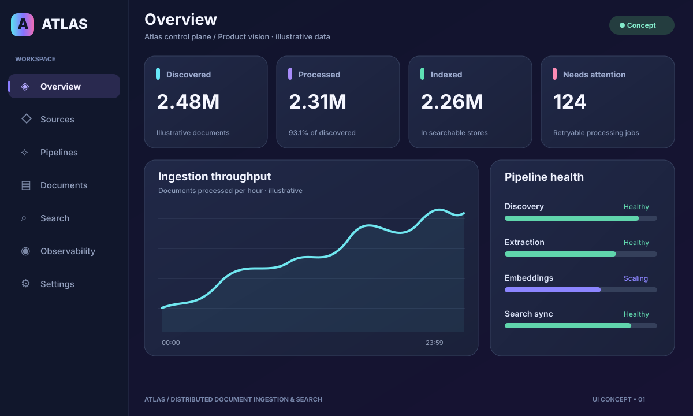
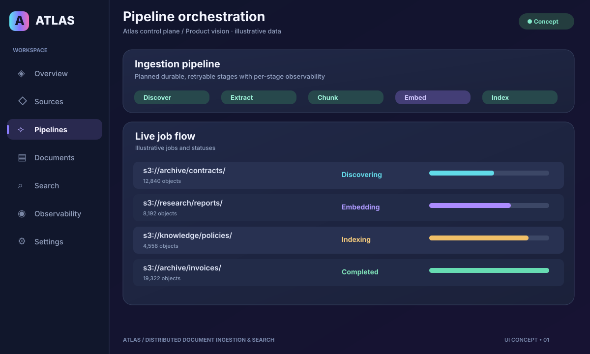
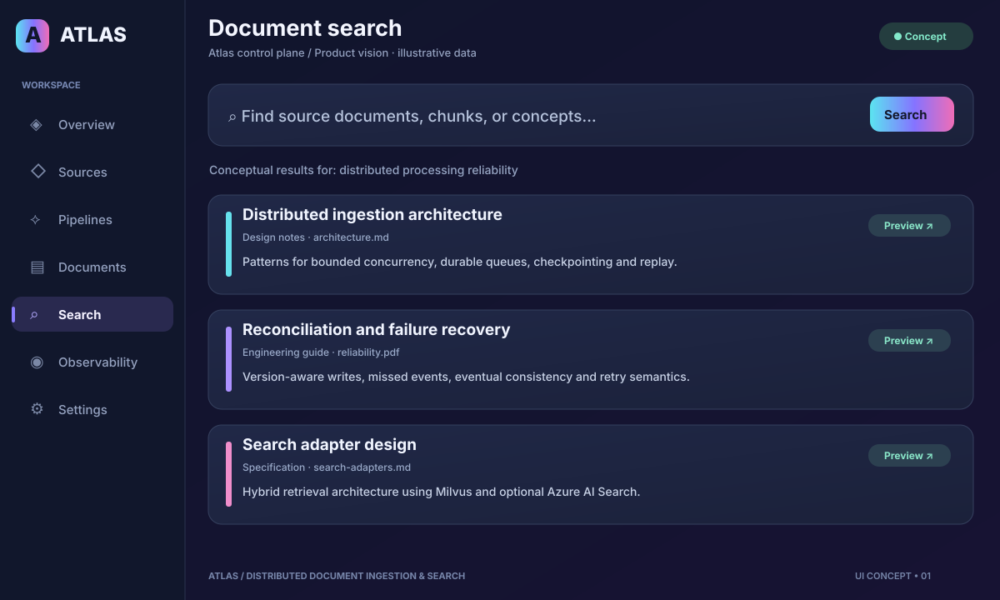

<div align="center">

# 🌌 Atlas

### Discover · Ingest · Process · Index · Search

**A vision for reliable, distributed document ingestion and search at scale.**

  

*Build the pipeline. Preserve the truth. Make every document discoverable.*

</div>

> [!IMPORTANT]
> **Atlas is a planned system, not an implemented application.** The screenshots below are **illustrative UI concepts using fictional sample data**, not captures of a working service. The repository currently contains architecture documentation only. Implementation starts after the Nexus project reaches its planned completion milestone.

## ✨ What Atlas could look like

A proposed visual direction for a future Atlas operations console: deep-indigo surfaces, aurora gradients, high-contrast telemetry, and calm, actionable pipeline statuses. The concepts are **not implemented UI features**.

### 📊 Mission control — ingestion at a glance



*Concept only — fictional discovery, processing, and indexing metrics.*

### 🔀 Pipeline orchestration — follow the data



*Concept only — illustrative stages, job queues, progress and retry visibility.*

### 🔎 Document search — retrieve with context



*Concept only — illustrative search results and placeholder documents.*

### 🎨 Proposed interface palette

| Surface | Color | Intended use |
| --- | --- | --- |
| 🌌 Midnight | `#10152C` | Main app canvas |
| 💜 Iris | `#8573FF` | Focus and interactive accents |
| 🩵 Aurora | `#5BE4F0` | Discovery and activity |
| 🌱 Mint | `#5EE0B4` | Healthy stages |
| 🌺 Orchid | `#EF6DB6` | Secondary accent and notices |

**Design artifacts:** [Dashboard](docs/images/atlas-dashboard-concept.svg) · [Pipelines](docs/images/atlas-pipeline-concept.svg) · [Search](docs/images/atlas-search-concept.svg)

---

<details>
<summary><strong>📐 Full architecture, engineering roadmap and technical notes</strong></summary>

# Atlas — Distributed Document Ingestion & Search

> **Discover. Ingest. Process. Index. Search — at scale.**

**Atlas** is a planned open-source platform for reliable, distributed ingestion and search across large collections of existing documents.

Instead of uploading files one at a time, Atlas will connect to external data sources such as **Amazon S3**, discover potentially millions of objects, process them through scalable workers, persist document and chunk metadata in **PostgreSQL**, store embeddings in **Milvus**, and optionally synchronize searchable content into **Azure AI Search** for hybrid retrieval.

**Project status: Planning / architecture definition.** This repository documents the intended direction; the features and infrastructure below are **not implemented yet**. Development is deliberately scheduled **after the Nexus project reaches its agreed completion milestone**.

---

## Why Atlas?

Organizations often have years of documents already stored in S3 buckets, object storage, shared systems, or internal repositories. Processing that existing content is fundamentally different from an application accepting a single upload.

Atlas is intended to explore and solve the engineering challenges behind:

- Discovering huge collections without repeatedly scanning everything.
- Parallelizing downloads, parsing, OCR, normalization, chunking, and embeddings.
- Surviving crashes, retries, duplicated events, partial failures, and provider outages.
- Detecting changed or deleted source objects and updating downstream indexes correctly.
- Keeping authoritative metadata, vector storage, and search indexes consistent.
- Measuring throughput, latency, retrieval quality, operational costs, and scale.

**Atlas is a data-ingestion and search infrastructure project, not another chatbot or agent framework.**

## Goals

1. **Source-agnostic ingestion** — start with S3; provide extensible connectors for additional sources.
2. **Distributed, resumable processing** — process large backlogs with bounded worker concurrency, batching, checkpoints, and backpressure.
3. **Durable metadata and processing state** — PostgreSQL tracks source identity, documents, versions, chunks, jobs, and indexing outcomes.
4. **Independent vector ownership** — Milvus stores generated chunk vectors and supports standalone vector retrieval.
5. **Optional enterprise search** — Azure AI Search holds a derived searchable projection for keyword, vector, hybrid, and optional semantic ranking.
6. **Incremental synchronization** — update only what changed, handle deletes and reprocessing, and reconcile missed events.
7. **Provider-independent interfaces** — avoid coupling the core platform to any one embedding provider, storage vendor, or search service.
8. **Benchmark-driven scalability** — prove behavior under realistic loads rather than relying on vector-count claims alone.
9. **Open-source accessibility** — make the core pipeline runnable without an Azure subscription or mandatory paid services.

## High-level architecture

```text
                  EXISTING DOCUMENT SOURCES
          Amazon S3 | Azure Blob | future connectors
                              |
                              v
                Source discovery / inventory
             Incremental scans and change detection
                              |
                              v
                 Durable job queue / scheduler
                              |
                              v
                    Distributed workers
       Download -> Extract / OCR -> Normalize -> Chunk
                              |
                              v
                         PostgreSQL
     Source identities | Documents | Versions | Chunks
        Job state | Checkpoints | Outbox | Index state
                              |
                              v
                      Embedding workers
              Batch requests; generate once
                              |
                              v
                           Milvus
            Vector persistence + vector retrieval
                              |
                  +-----------+-----------+
                  |                       |
                  v                       v
           Milvus search            Index sync workers
           (open-source)           Retry / reconcile
                                          |
                                          v
                                   Azure AI Search
                                       (optional)
                                 Text + vector + metadata
                               BM25 / hybrid / semantic
                  |                       |
                  +-----------+-----------+
                              |
                              v
                   Atlas Retrieval / Search API
            Access scope -> ranking -> results / metrics
```

**The arrows describe intended logical stages, not a requirement to process each stage synchronously.** The implementation should use durable handoffs, version-aware IDs, and retryable workers.

### Data ownership

| Component | Responsibility | Source of truth? |
| --- | --- | --- |
| External sources (e.g., S3) | Original objects and source metadata | Yes, for source content |
| PostgreSQL | Document identities, metadata, normalized chunks, versions, processing and sync state | Yes, for Atlas application state |
| Milvus | Persisted chunk embeddings and independent vector search | Yes, for Atlas's stored vectors |
| Azure AI Search (optional) | Search-optimized projection of chunk text, vectors, and filterable metadata | **No** — rebuildable derived index |
| Queue / workers | Asynchronous delivery and execution | No — durable job state is reconciled against PostgreSQL |

**One embedding generation, multiple destinations:** embeddings should be generated once per model/content version, persisted in Milvus, then reused for Azure AI Search indexing rather than regenerated separately. Cross-system writes are not one database transaction; workers must handle partial success safely.

## Planned capabilities

### 1. Connectors and source discovery

**Initial connector: Amazon S3.**

- Discover objects by bucket, prefix, and configured scope.
- Paginate safely; checkpoint long-running enumeration.
- Evaluate **S3 Inventory** for large existing buckets and regular reconciliation; use change-event integration where appropriate.
- Track source identifiers, object versions (when enabled), checksums/content hashes when available, size, timestamps, and processing status.
- Avoid treating S3 ETags as universally reliable content hashes (for example, multipart uploads differ).
- Support idempotent scheduling, incremental rescans, deletes, and configurable exclusion rules.

**Future connectors to evaluate:** Azure Blob Storage, S3-compatible storage, shared-drive/document systems, and other enterprise sources. Connector support beyond S3 is roadmap scope, not a current feature.

### 2. Distributed document processing

- Stream or download source objects within configurable memory and size budgets.
- Start with **TXT, Markdown, and text-based PDF**; expand to additional formats and scanned-PDF OCR deliberately.
- Normalize extracted content while retaining source and page/section provenance.
- Apply deterministic, configurable chunking (size, overlap, structural boundaries).
- Persist chunk text and metadata in PostgreSQL with stable IDs and document version associations.
- Parallelize across files; cap expensive per-file work and OCR concurrency.
- Avoid putting large document payloads directly into queue messages.

### 3. Embedding generation and Milvus

- A provider-neutral embedding interface, with configurable model and dimensions.
- Batch embedding requests while respecting throughput limits, token budgets, and provider errors.
- Track content fingerprints, embedding model/version, dimensions, and vector IDs.
- Make embedding writes idempotent and safe to retry.
- Use Milvus Standalone for initial development; evaluate distributed Milvus only when workload measurements justify it.
- Expose Milvus-backed vector similarity search for local, open-source deployments.

Milvus is **not** a replacement for PostgreSQL's relational metadata and workflow state. Atlas does **not** require pgvector: Milvus is the planned vector database in this project.

### 4. Azure AI Search (optional adapter)

- Push chunk text, embeddings, and filterable metadata into Azure AI Search.
- Support keyword/BM25, vector, hybrid, and optional semantic ranking where configured.
- Use deterministic index document IDs and explicit schema/model versions.
- Index asynchronously in bounded batches with rate limits and retry/backoff.
- Maintain deletion and update propagation, index rebuilds, reconciliation, and drift detection.
- Support alternate search adapters without requiring Azure for the open-source core.

**Important:** Azure AI Search does not query Milvus directly. It stores its **own copy** of indexed vectors and content. Atlas must explicitly synchronize the two systems.

### 5. Retrieval and evaluation

- A common search contract so callers can compare Milvus vector search and Azure AI Search retrieval.
- Configurable metadata filtering and, for multi-tenant deployments, enforced authorization scope.
- Search diagnostics including source document, chunk ID, score/rank, model/index version, and timing.
- Retrieval test datasets with relevance judgments to measure recall@k, precision@k, nDCG, and latency.
- Clear separation between backend-specific ranking and Atlas's stable public search responses.

### 6. Reliability, security, and operations

- Durable processing lifecycle (e.g., discovered, queued, processing, processed, embedding, indexed, failed, deleted).
- Idempotency keys and per-stage retries with backoff, dead-letter handling, and operator replay.
- Version-aware upserts/deletes and protection against stale workers overwriting newer results.
- Transactional outbox or equivalent durable handoff for PostgreSQL state changes.
- Reconciliation loops to repair PostgreSQL/Milvus/Azure drift.
- Bounded concurrency, backpressure, rate limiting, and safe resource usage.
- Structured logs, tracing, metrics, operational dashboards, and auditable job history.
- Least-privilege source credentials, secrets management, encryption in transit, and content-safe logging.
- Tenant/source access controls if multi-tenancy is introduced; search-index filters alone must never be treated as the final authorization authority.

## Initial technology direction

| Layer | Planned technology |
| --- | --- |
| Language | Python 3.12+ |
| API / control plane | FastAPI |
| Metadata and chunk store | PostgreSQL + SQLAlchemy / migrations |
| Vector database | Milvus |
| Primary external source | Amazon S3 (boto3) |
| Search adapter | Azure AI Search (**optional**) |
| Background jobs | Distributed Python workers |
| Messaging | RabbitMQ **or** Azure Service Bus; select during design |
| Embeddings | Provider-neutral adapter; model selection TBD |
| Local development | Docker Compose |
| Tests and quality | pytest, integration tests, linting, typing |
| Observability | OpenTelemetry / Prometheus / Grafana (to evaluate) |
| Large-scale deployment | Container orchestration and independently scalable workers (later phase) |

This is a **proposed stack**, not a claim of existing integrations or a final dependency lock-in.

## Ingestion and consistency model

A successful ingestion should eventually produce matching versions of the same document across PostgreSQL, Milvus, and any enabled search adapters:

1. Discover an object and record its source identity/version in PostgreSQL.
2. Enqueue a bounded processing job; deduplicate retries against persistent state.
3. Extract, normalize, and chunk the content with provenance.
4. Commit current document/chunk state and the next durable work item.
5. Generate and persist embeddings in Milvus; checkpoint the embedding model and chunk version.
6. Dispatch a version-aware indexing job and write a searchable projection to Azure AI Search if enabled.
7. Mark the intended version indexed only after the destination acknowledges success.
8. Reconcile failures and remove stale vectors/index entries after updates or deletes.

**Consistency is eventual across stores.** The queue is not the authoritative database; job progress and recovery must be reconstructible. Search results must not expose deleted, superseded, or unauthorized content.

## Scaling strategy

Scale based on **number of chunks, embedding dimensionality, document size, ingestion rate, query concurrency, index size, and cost**, not just raw document count.

- **Small workloads:** one source connector, bounded workers, PostgreSQL, Milvus Standalone, optional Azure adapter.
- **Growing workloads:** multiple workers, controlled batching, source inventory, dead-letter/replay, and performance monitoring.
- **Large workloads:** independent worker pools for discovery/extraction/embedding/indexing, incremental processing, partitioning, and index lifecycle tuning.
- **Very large workloads:** benchmark distributed Milvus, tenant/workload isolation, bulk imports, storage/index optimization, and infrastructure cost.

A million documents may create tens of millions of vectors depending on the chunking policy; there is no universal vector-count threshold that forces a specific infrastructure choice.

## Learning and delivery roadmap

The roadmap is deliberately phased. Targets below are **learning/benchmark goals**, not current capabilities or performance guarantees.

| Phase | Example dataset target | Outcome |
| --- | ---: | --- |
| **0 — Design** | — | Contracts, data model, source identities, worker boundaries, indexing and failure semantics |
| **1 — Local vertical slice** | 1,000 documents | S3 -> parsing/chunking -> PostgreSQL -> embeddings -> Milvus -> searchable API |
| **2 — Distributed ingestion** | 50,000 documents | Queue, concurrency, checkpoints, retries, incremental updates, recovery |
| **3 — Azure adapter and search** | Variable | Sync to Azure AI Search; hybrid retrieval, permissions, consistency and comparison |
| **4 — Scale and benchmark** | Up to 1 million documents | Load tests, profiling, vector/index capacity, recall/latency/cost analysis |
| **5 — Open-source hardening** | Realistic fixtures | Documentation, setup scripts, CI, examples, contribution guide, release preparation |

### Benchmarks we want to publish

- Documents/hour and chunks/second by stage and file type.
- Embedding throughput, provider request rate, token usage, and cost.
- End-to-end ingestion lag and Azure indexing delay.
- Worker retry rate, failed-job recovery time, and duplicate processing rate.
- Milvus versus Azure query latency (p50/p95/p99) under load.
- Recall@k, precision@k, nDCG, filter correctness, and freshness.
- CPU, RAM, disk, vector-index size, and infrastructure cost as the corpus grows.

Benchmarks will state hardware, dataset shape, embedding model, concurrency, and search configuration so results remain reproducible and honest.

## Relationship to Nexus

[**Nexus**](https://github.com/summiya/nexus) and Atlas are **independent projects with different goals**.

| Nexus | Atlas |
| --- | --- |
| AI workspace, conversations, RAG, agents, tools/MCP | Distributed ingestion, vector indexing, and search infrastructure |
| Primarily application-driven document uploads | Primarily existing documents discovered in external sources |
| PostgreSQL + **pgvector**; Azure AI Search for retrieval | PostgreSQL + **Milvus**; optional Azure AI Search adapter |
| Prioritize usable AI product workflows | Prioritize fault tolerance, throughput, indexing consistency, and benchmarking |

Atlas is **not** a Nexus microservice, migration, or replacement. Shared ideas may inform both projects, but there is no planned hard runtime dependency. **Nexus remains the active development priority; Atlas implementation begins afterward.**

## Repository status and getting started

This repository currently contains **project direction and planning only**.

- There is **no runnable Atlas service** yet.
- Docker Compose files, API endpoints, environment templates, and installation commands will be added during implementation.
- **Do not** infer that the architecture diagram, roadmap, or listed integrations are deployed.
- A getting-started guide with reproducible local setup and sample S3-compatible data will accompany the first working vertical slice.

## Open-source direction

The aim is to build a genuinely useful, extensible open-source platform for learning and real-world document pipelines. The default core should run locally with PostgreSQL and Milvus, without Azure AI Search or a paid embedding provider being mandatory.

A license, contribution policy, security reporting guidance, and supported release policy will be selected **before the first public code release**. Until a license is added, the repository's public visibility **does not itself grant an open-source license**.

---

**Atlas: distributed ingestion first, reliable search second, measurable scale throughout.**

</details>
