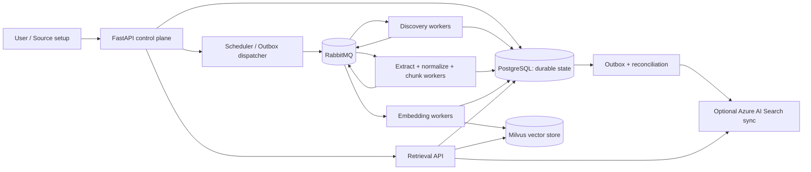

# Atlas source-first architecture (proposed v0.1)

> Status: **design proposal and interactive demo only**. This document is a starting specification, not a claim of implemented integration.

## Product boundary

Atlas is a source-to-search ingestion system. It connects to existing sources, discovers records or files, normalizes content to versioned documents, builds chunks and embeddings, and exposes searchable material through Milvus. Azure AI Search is an optional *separately synchronized* destination. An AI copilot may explain and recommend actions but cannot bypass deterministic jobs or credential controls.

**First user journey:** Add source → Test credentials → Discover schema/objects → Select scope → Configure mapping/sync → Preview records → Start first run → Observe per-stage status and failures → Search indexed documents → Run incremental update.

## Initial connector decisions

1. **S3 / S3-compatible object storage:** first working integration for TXT, Markdown, text-based PDFs; scan bucket/prefix, checkpoint pagination; compare object versions/content fingerprints and reconcile deletions. Never assume an ETag is a content hash.
2. **PostgreSQL source (next):** read-only connection; enumerate schemas/tables; select primary key, text-bearing columns, and a user-chosen incremental cursor; map rows to document text and metadata with stable source IDs. For v0, support initial snapshot and timestamp polling, with cursor overlap and idempotent upsert. **CDC is a later separately designed mode** (WAL permissions, replication slot lifecycle, backfills, and delete handling).
3. **Local fixture connector:** enables integration tests and development with no cloud credentials.

A connector follows the interface `validate(config)`, `discover(config)`, `read(scope,cursor)`, `checkpoint()`, `reconcile(scope)`. Connector output must be typed records with stable IDs, source version, source timestamp, optional ACL metadata, and raw content pointer. Secrets are never returned by read APIs.

## Target logical architecture

The diagram represents logical stages, not a single queue binding. Stage-specific routing keys and concurrency limits avoid embedding or OCR work starving discovery. PostgreSQL is authoritative for job progress, source/record identity and current document version. Milvus holds vectors. Azure's index is rebuildable, and stores its own copy, not a live query of Milvus. Embeddings are generated once per content/model version and reused for destinations.

## Data model: minimum tables

| Table | Important fields / constraints |
|---|---|
| `sources` | id, kind, name, config_redacted, credential_ref, created_at |
| `source_scopes` | id, source_id, selected tables/prefixes, mapping_config, sync_mode, schedule |
| `source_cursors` | scope_id, opaque_cursor, checkpoint_version, committed_at |
| `ingestion_runs` | id, scope_id, status, started_at, completed_at, counts |
| `source_items` | source_id, stable_external_id, external_version, fingerprint, deleted_at |
| `documents` | id, source_item_id, version, canonical_content_ref, metadata, status |
| `chunks` | id, document_id, document_version, position, text, provenance, content_fingerprint |
| `embedding_records` | chunk_id, model_id, model_version, vector_id, status |
| `index_states` | document_version, destination, index_version, state, error |
| `jobs` | id, run_id, stage, attempt, idempotency_key, status, last_error |
| `outbox_events` | id, kind, payload_ref, delivered_at, retry_count |

Use uniqueness on `(source_id, stable_external_id)` and on version-aware chunk/embedding IDs. Store large raw bodies outside queue messages (object-store staging or bounded text persistence). No credentials in outbox, logs, or frontend payloads.

## State and failure behavior

`discovered → queued → extracting → chunked → embedding → vector_indexed → search_synced`; independent `failed`, `retry_pending`, `deleted` branches. Optional Azure sync must not block readiness of Milvus search. A per-stage attempt has bounded retries, exponential backoff and a dead-letter path. Advance source checkpoints **only after records covered by that checkpoint are durably accepted**, so a crash cannot silently skip items. Treat delivery as at-least-once: every side effect needs idempotent version-aware upsert. Later/older jobs must not overwrite the newest document state. Deletions tombstone source items and asynchronously remove matching vectors/projections; the search API must filter noncurrent or unauthorized documents using current PostgreSQL state.

## Minimum API contract

- `POST /v1/sources` — create source with secret reference; do not return secrets
- `POST /v1/sources/test` — validate reachability and read permissions
- `GET /v1/sources/{id}/catalog` — enumerate schemas/tables or prefixes
- `POST /v1/source-scopes` — persist mapping, sync mode, schedule
- `POST /v1/source-scopes/{id}/preview` — bounded sample and output preview
- `POST /v1/ingestion-runs` — start a durable run, return run ID
- `GET /v1/ingestion-runs/{id}` — stage status/counts/failures and cursor
- `POST /v1/ingestion-runs/{id}/retry-failed` — audited operator action
- `POST /v1/search` — tenant-filtered Milvus search with document provenance
- `GET /v1/documents/{id}` — current versions/chunks/index status

All mutations require authorization and audit; source networking must restrict SSRF/internal targets. Use read-only source credentials and test with minimum privilege.

## Delivery slices

**Slice 0 — user flow + contract:** click-through UI prototype, DB schema, API contract, architecture decision records, demo fixtures.

**Slice 1 — working vertical slice:** Docker Compose, FastAPI, PostgreSQL, Milvus Standalone, local fixture + S3 connector, deterministic TXT/MD processing, simple local embedding option, vector search. No Azure dependency.

**Slice 2 — durability:** RabbitMQ, independent workers, checkpoints, idempotency, source updates/deletes, replay, basic metrics.

**Slice 3 — PostgreSQL source:** source test, catalog, selected tables, row→document mapping, snapshot and timestamp incremental sync. Explicitly defer WAL/CDC.

**Slice 4 — optional enterprise retrieval:** Azure AI Search index adapter, authorization enforcement, consistency reconciliation, benchmark suite.

## UI: not a generic admin dashboard

The primary workspace is a **source-to-knowledge journey**:
- Connected-source cards with last sync, permissions and scope.
- Source wizard: choose type, connect/test, discover/select, preview, configure schedule.
- Pipeline canvas where each stage opens its real log, throughput, retry count, lineage.
- Search lab: search corpus, inspect exact source row/file, chunk, embedding version, and index state.
- Optional Atlas copilot for *explanation and suggestions only*. Do not show synthetic AI metrics as live.

A standalone local demo lives at [`../prototype/index.html`](../prototype/index.html). It simulates user actions with seeded sample data and **does not connect to real databases**.

## Decisions to confirm

1. Does Atlas remain **document/search infrastructure**, or should it also support general-purpose ETL destinations? **Proposed: document/search only**, with row-to-document mapping.
2. Which first source: **S3** (existing repo plan) or PostgreSQL? Proposed: deliver S3 first and design PostgreSQL simultaneously.
3. Should CDC arrive with Postgres v1? **Proposed: no**; start snapshot+timestamp, add WAL-based CDC after recovery tests.
4. Should AI copilot write configuration? **Proposed: suggestions with user approval only**.

## Studied implementations and discussions

- Airbyte connector protocol (Spec, Check, Discover, Read): https://github.com/airbytehq/airbyte/blob/master/docs/platform/connector-development/cdk-python/basic-concepts.md
- Airbyte checkpoints and state: https://github.com/airbytehq/airbyte/blob/master/docs/platform/understanding-airbyte/airbyte-protocol.md
- Onyx Load/Poll/Slim connectors: https://github.com/onyx-dot-app/onyx/blob/main/backend/onyx/connectors/README.md
- Debezium AI/CDC approach: https://debezium.io/ai/
- Unstructured ingest: https://github.com/Unstructured-IO/unstructured-ingest
- Reddit production extraction discussion: https://www.reddit.com/r/Rag/comments/1so4hcx/
- Reddit high-volume CDC discussion: https://www.reddit.com/r/dataengineering/comments/16jh2aw/

Architectural references are inputs, not endorsements or performance guarantees.
